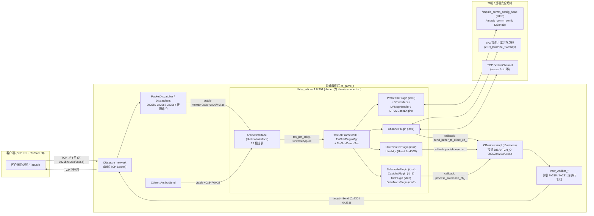

# `tss_sdk`（`libtss_sdk.so.1.0.394`）源码还原与通信架构说明

本目录是 DNF 1031 服务端安全组件 `libtss_sdk.so.1.0.394`（游戏服 `df_game_r` 运行时按 `./libantisvrimport.so` 动态加载）的源码还原与构建工程。

- **目标二进制**：`libtss_sdk.so.1.0.394`（ELF32 i386，GCC 4.1 / GNU C++98 ABI，`_GLIBCXX_USE_CXX11_ABI=0`，参考原版 SHA-256：`8f6263dae6fcd1eb19baece6f7c9408d2161abd1a05bd492d398d5cb7783d2a7`）。
- **运行形态**：**进程内动态库**，不是独立守护进程，也不直接持有玩家 TCP socket。玩家网络收发始终经过 `df_game_r` 的 `CUser`；SDK 通过虚表被 `df_game_r` 调用，并通过 `IBusiness` 回调把待下发安全包或判罚指令投递回 `df_game_r` 消息队列。
- **证据边界**：本文关于服务端、SDK 内部插件与协议结构的描述均直接取自 `dnf_secsvr/tss_sdk` 及 `dnf_remake/source/DNFServer/GameServer` 源码；客户端 `TerSafe.dll` 无源码，所有关于客户端内部实现的推断均显式标为 **`[INFERENCE]`**。

---

## 1. 核心功能概览

`libtss_sdk.so.1.0.394` 在服务端承担四类安全与风控职责：

| 子系统 | 核心类 / 命名空间 | 功能职责 |
|---|---|---|
| **1. DP 动态协议保护（DPROTO）** | `::DPInterface`、`tss_dpsdk::DPMsgHandler`、`DPVMBaseEngine`、`DPCodeMgr`、`DPHackMgr`、`CVM` / `CUPVM`、`CCryptData` | 维护每个在线用户的协议安全状态机（`E_CLIENT_STATE`）；按配置判定上下行命令号是否需要加解密（`IsCmdInUpList` / `IsCmdInDownList`）；使用固定算法或字节码虚拟机（`VMCore` + 26 种 `TenCrypt` 算法）对游戏包与 DP 控制包加解密；向客户端下发动态字节码（`client_code_` / `server_code_`）、二进制模块（`bin_file_`）与上下行受保护命令表；执行包序列、包延迟、命令丢弃、封禁模式及特定业务（如 CF/DNF）外挂检测（`IDPHacker` 派生族）。 |
| **2. AntiBot 反外挂通道** | `TssSdkProtoProcPlugin`（`ETSS_SDK_PLUGIN_ID_PROTO_PROC = 3`） | 接收客户端上报的反外挂探测数据（外层命令 `0x25b` 或 DP 头 `data_type_ == 1`），处理 `0x78`/`0x79` 通道延迟探测时间戳，封装为 `sec_proto::RecvDataFromSDKReq`（命令 `0x4c6ab`）转发给后端 `secsvr`；接收后端 `sec_proto::SendToSDK`（命令 `0x493e1`）并经 `df_game_r` 下发给客户端（外层命令 `0x230`）。 |
| **3. SafeMode / MBA 与验证码（Captcha）** | `TssSdkSafemodePlugin`（`id = 4`）、`TssSdkCaptchaPlugin`（`id = 5`） | 查询与同步账号安全模式/密保（MBA）状态、限制状态、验证 URL 与操作结果；向后端请求验证码图片、转发客户端答案验证、在验证完成后通知恢复鼠标或解除限制。 |
| **4. 用户输入审查与脏词过滤（UIC / `tdirty`）** | `TssSdkUicPlugin`（`id = 6`）、`UicManager`、`CDirtyCheck`（`oidirty`） | 提供本地脏词库（中文 GBK、拼音、英文、正则、`charactermap` 归一化）检测与替换（`OIDirtyCheck*` / `OIDirtyReplace*`），并支持通过异步队列/TCP 连接向后端 UIC 服务上报聊天与角色名审查。 |

---

## 2. 目录与代码结构

```text
dnf_secsvr/tss_sdk/
├── build_server.py                     # 唯一构建入口（编译 228 个 TU 并链接 libtss_sdk.so.1.0.394）
├── recon/                              # 按原版 DWARF 与符号还原的源码与头文件
│   ├── link_check.sh                   # 重建 TU 清单（91 个 host GCC 编译单元）与局部链接检查脚本
│   ├── vendor_only_tus.txt             # 需用 CentOS 5 GCC 4.1.2 编译以保留弱内联符号的 TU 清单
│   ├── inc/                            # 公共基础头（common/Types.h, VMCore/cryptdata.h）
│   ├── include/
│   │   └── TenCrypt.h                  # 26 种 Ten* 对称加密/混淆原语声明
│   └── src/
│       ├── static_init_block.h         # 复现原版每 CU 独立 __ioinit 与 16 项 COMM_STAT 静态构造块
│       ├── static_init_block_impl.h
│       ├── ioinit_block.h
│       ├── VMCore/                     # 字节码虚拟机与密码算法分派（CVM, CUPVM, CCodeEngine, CCryptData）
│       ├── tdirty/                     # 本地脏词过滤引擎（oidirty, tdirtyapi, charactermap, md5, tagentapi）
│       ├── appcomm/                    # 进程间通道 ID 管理器（CAppBusChannelIdMgr）
│       ├── commlib/                    # 底层通信与容器基础库
│       │   ├── comm_buddy_alloc.*      # 伙伴内存分配器
│       │   ├── framework/              # Comm_App_Frame、SocketChannel、IPC/CFGSVR 适配层
│       │   └── zenlib/                 # ZEN 基础库（epoll/reactor、共享内存双向管道、读写锁、日志、状态统计）
│       ├── origsrc/                    # TDR 生成协议与 XML 配置序列化实现（sec_proto::*, tss_sdk_conf_desc::*）
│       ├── closing/                    # 导出入口（tss_get_sdk 等）、共享内存 dp_config 加载器、纯虚基类 vtable 发射器
│       ├── emission/                   # 密码算法静态查找表、哈希表素数表、模板显式实例化
│       └── formmog/tss_sdk/            # TSS SDK 核心业务实现
│           ├── adapter/                # 面向 df_game_r 的 IAntibotInterface / AntibotInterface 18 槽适配器
│           ├── busi_interf/            # 面向 C 表调用方的业务接口封装（anti/captcha/safemode/uic）
│           ├── framework/              # TssSdkFramework、TssSdkPluginMgr、TssSdkCommSvc 头文件与预定义
│           ├── layout/                 # 基于原版 DWARF 的单源结构体布局定义与编译期偏移/尺寸断言
│           └── plugins/                # 7 大插件与 DP 核心实现
│               ├── channel_plugin_agent.cpp
│               ├── usercontrol_plugin_agent.cpp
│               ├── proto_proc_plugin_agent.cpp
│               ├── uic_plugin_agent.cpp
│               ├── tss_sdk_config_shared.h
│               └── proto_proc/         # DPInterface、DPMsgHandler、DPMsgPacker、DPVMBaseEngine、DPHackMgr 等
└── reuse/                              # 相邻目录复用编译单元选择记录
    ├── OVERRIDES.txt                   # 已由 recon/ 接管并覆盖的复用对象列表
    └── log/                            # *.res 候选记录与 _min_*/_full_* 头文件搜索根（指向 ../source/secagent 等）
```

### 2.1 五类编译单元与构建方式

`build_server.py` 将 228 个编译单元分为五类，并在链接阶段使用 `-Wl,-z,defs` 强制拒绝任何未解析应用符号：

1. **`recon`（91 个 TU）**：位于 `recon/link_check.sh` 清单内，由宿主 `g++ -m32 -std=gnu++98 -O2 -fPIC -fno-implement-inlines -fno-stack-protector -D_GLIBCXX_USE_CXX11_ABI=0` 编译。
2. **`reuse`（108 个 TU）**：由 `reuse/log/*.res`（排除 `reuse/OVERRIDES.txt` 中已被 `recon` 接管的 4 个 TU）指定，直接复用 `dnf_secsvr/source/secagent`、`gunnersvr`、`zergsvr`、`tencrypt_new` 中的同源密码学（DES 变种、Blowfish、CAST、IDEA、MARS、RC2/4/5/6、Rijndael、Twofish、GOST、FEAL8、LOKI、SAFER、Square、TEAN、CRC32/MD2/MD4/MD5/SHA1/RIPEMD/HAVAL 等）、TDR 基础库及 `zenlib`/`commlib` 实现，由 `dnf_remake/toolchains/c5root/usr/bin/g++`（GCC 4.1.2）编译。
3. **`vendor`（2 个 TU）**：`recon/vendor_only_tus.txt` 中的 `src/VMCore/tencrypt_ts_local.cpp` 与 `ts_local_imp.cpp`，用 GCC 4.1.2 编译以生成与原版一致的弱内联符号。
4. **`generated`（22 个 TU）**：`recon/src/origsrc/*.cpp` 下的 TDR 协议与 XML 配置代码，用 GCC 4.1.2 编译。
5. **`closing`（5 个 TU）**：`recon/src/closing/*.cpp`（导出符号、共享内存配置与基类 vtable 发射器），用宿主 `g++ -m32` 编译。

构建命令（在 WSL 下执行）：

```bash
cd dnf_secsvr/tss_sdk          # rednf 发布树: cd remake/secsvr/tss_sdk
python3 build_server.py --jobs 8 --output-dir /tmp/tss_sdk_build
ldd -r /tmp/tss_sdk_build/libtss_sdk.so.1.0.394
```

rednf 发布树不包含预生成的 `toolchains/c5root`；首次构建前先执行 `toolchains/bootstrap.sh`。`build_server.py` 会自动识别 `dnf_workspace` 与 `rednf` 两种目录布局。

### 2.2 内存布局与静态初始化还原机制

- **单源布局契约（`recon/src/formmog/tss_sdk/layout/`）**：关键类（如 400 字节的 `tss_sdk_impl::UserInfo`、12 字节的 `::DPInterface`、68 字节的 `tss_dpsdk::DPVMBaseEngine`、56 字节的 `TssSdkPluginMgr`、40 字节的 `TssSdkCommSvc`）均通过 `layout_contract.h` 中的 `TSS_SDK_STATIC_ASSERT` 和 `TSS_SDK_OFFSET_CONTRACT` 在编译期校验 `sizeof` 与每个字段的 `offsetof`。
- **每 CU 静态构造块（`recon/src/static_init_block_impl.h`）**：原版每个编译单元均独立包含 `std::ios_base::Init __ioinit` 与 16 项 `COMM_STAT_ITEM_WITH_NAME`（统计项 ID `0x238d..0x239c`）。合并多个原版 CU 的还原文件通过定义不同的 `TSS_SDK_STATIC_INIT_ID` 多次包含该头文件，保持静态构造次数与析构注册顺序与原版一致。

---

## 3. `tss_sdk` 如何与服务端其他部分通信

`tss_sdk` 位于**宿主游戏服进程（`df_game_r`）**与**后端安全服务（`secagent` / `secsvr` / `uic` / 共享内存配置）**之间。整体拓扑如下：



### 3.1 与宿主游戏服 `df_game_r` 的进程内通信

#### （1）动态加载与初始化

1. **导出入口**：`tss_sdk` 对外提供两套入口：
   - 供 `df_game_r` 直接使用的工厂函数 `extern "C" IAntibotInterface *GetAntiBotInterfaceAll()`（`recon/src/formmog/tss_sdk/plugins/proto_proc/tss_sdk_exports_timer_agent.cpp:677`），返回全局单例 `&g_antibot_if`（4 字节对象，仅含 `vptr`）。
   - 底层 C 函数表入口 `extern "C" TssSdkInterface *tss_get_sdk()`（`recon/src/closing/exports_surface.cpp:139`），返回 28 字节静态函数指针表（`init`、`init_plugins`、`fini`、`proc`、`notify`、`get_last_error_code`、`get_last_error`），以及 `tss_sdk_get_{comm,anti,captcha,safemode,uic}_interf` 和 `tss_sdk_release_busi_interf`。
2. **宿主加载链**：`df_game_r` 启动时在 `GlobalData/Init_3.inc:648-671` 创建 `GlobalData::s_antibotBusinessImpl_ = new CBusinessImpl`，随后调用 `CreateAntiServerObj("./")`（`dnf_remake/source/DNFServer/GameServer/Game/GlobalData.cpp:2852`）：
   - 拼接 `./libantisvrimport.so`，调用 `dlopen(..., RTLD_NOW)` 与 `dlsym("GetAntiBotInterfaceAll")` 获取 `GlobalData::s_antibotChecker_`。
   - 调用虚表槽 `+0x00` `Initialize(s_antibotBusinessImpl_, processSequenceStr)`。
3. **插件注册与激活**：`AntibotInterface::Initialize`（`recon/src/formmog/tss_sdk/adapter/antibot_client_agent.cpp:140`）将 `ipc_path_name` 解析为整数 `g_channel_id`，先调 `g_tss_sdk->init(g_channel_id)`（读取 `./antisvrimport_conf_path.xml` -> `./antisvrimport_conf.xml`，初始化 `/tmp/tss_sdk_<id>` 日志），再调 `g_tss_sdk->init_plugins(plugin_array, 5)` 依次激活 5 个插件并绑定回调：
   - `ETSS_SDK_PLUGIN_ID_CHANNEL (1)`：回调 `send_buffer_to_client_cb_`，传入 `TssSdkInitChannelData`（`unique_instance_id_ = g_channel_id`，`ipc_bus_size_ = 0x800000` 即 8 MiB，`pid_channel_mode_ = 0`）。
   - `ETSS_SDK_PLUGIN_ID_PROTO_PROC (3)`：初始化 `DPInterface::instance()->init(...)` 与 `/tmp/dp_comm_config*` 共享内存配置。
   - `ETSS_SDK_PLUGIN_ID_USER_CONTROL (2)`：回调 `punish_user_cb_`。
   - `ETSS_SDK_PLUGIN_ID_SAFEMODE (4)`：回调 `process_safemode_cb_`。
   - `ETSS_SDK_PLUGIN_ID_CAPTCHA (5)`：无直接 `IBusiness` 回调。

#### （2）正向调用：`df_game_r` -> `IAntibotInterface`（18 槽虚表）

`IAntibotInterface` 定义于 `recon/src/formmog/tss_sdk/adapter/iantibotinterface.h:39`。`df_game_r` 通过 `GlobalData::s_antibotChecker_` 的虚表偏移直接调用：

| 虚表偏移 | 方法签名 | SDK 内部行为 | `df_game_r` 调用位置 |
|---|---|---|---|
| `+0x00` | `Initialize(IBusiness*, char*)` | 初始化 `TssSdkFramework` 并激活插件 `1, 3, 2, 4, 5` | `GlobalData/Init_3.inc:662` |
| `+0x04` | `AddClient(int, int, uint uin, uint cli_ver, TUserInfo*)` | 向 `USER_CONTROL` 发送 `ADD_USER(1)`，在 `UserMgr` 分配 400B `UserInfo` 并调用 `DPInterface::add_user`（置 `ECS_NOT_INIT`），**返回槽位索引 `idx_`** | `InterDispatcher/dispatch_sig_20.inc:152`（返回值存入 `user->setAntibotKey(ret)`） |
| `+0x08` | `DeleteClient(int, int, uint uin)` | 向 `USER_CONTROL` 发送 `DELETE_USER(2)`，调用 `DPInterface::del_user` 写账单并释放 `UserInfo` | `CUser/prepareDisconnect.inc:44` |
| `+0x0c` | `OnRecvBufferFromClient(int, int, uint uin, u8* buf, u16 len)` | 向 `PROTO_PROC` 发送 `ANTIBOT_PKG(309)` -> `handle_antibot_pkg` 转发给后端 `secsvr` | `Dispatchers/dispatch_sig_9.inc:68`（外层包 `0x25b`） |
| `+0x10` | `ProcessAntiBotInput()` | 调用 `TssSdkFramework::proc()`：轮询后端 IPC/Socket 收包并驱动各插件定时逻辑 | `GameMain.cpp:153`（主循环 `ProcessAntiBotInputWrapper`） |
| `+0x14` | `CheckTimer(int, int, uint)` | 原版为空实现（`xor eax,eax; ret`，定时检查实际由 `proc()` 内部触发） | `antibotinterface_trivial.cpp:20` |
| `+0x18` | `SetLogPath(char*)` | 原版为空实现（`ret`） | `antibotinterface_trivial.cpp:25` |
| `+0x1c` | `ShowInfo()` | 原版为空实现（`ret`） | `antibotinterface_trivial.cpp:29` |
| `+0x20` | `P2PAddClient(uint, int, uint)` | 原版为空实现（返回 `0`） | `InterDispatcher/dispatch_sig_20.inc:160` |
| `+0x24` | `P2PDeleteClient(uint)` | 原版为空实现（返回 `0`） | `CUser/prepareDisconnect.inc:47` |
| `+0x28` | `RecvBufferForEncrypt(uint key, u8* in, uint in_len, u8* out, uint& out_len)` | 向 `PROTO_PROC` 发送 `ENCRYPT_PKG_OLD(307)`（`idx_ = key`）-> `DPInterface::recv_buffer_for_encrypt` | `CUser/AntibotSend.inc:60` |
| `+0x2c` | `RecvBufferForDecrypt(uint key, u8* in, u16 in_len, u8* out, u16& out_len)` | 向 `PROTO_PROC` 发送 `DECRYPT_PKG_OLD(308)`（`idx_ = key`）-> `DPInterface::recv_buffer_for_decrypt` | `Dispatchers/dispatch_sig_13.inc:34`（`0x25c`）、`Dispatchers.cpp:2495`（`0x25d`） |
| `+0x30` | `IsCmdInUpList(uint key, int cmd_id)` | 发送 `IS_CMD_IN_UP_LIST(304)` -> `DPMsgHandler::is_need_decrypt`（命中返回 `0`，未命中返回 `-1`） | `PacketDispatcher/doDispatch.inc:69` |
| `+0x34` | `IsCmdInDownList(uint key, int cmd_id)` | 发送 `IS_CMD_IN_DOWN_LIST(305)` -> `DPMsgHandler::is_need_encrypt`（命中返回 `1`，未命中返回 `0`） | `CUser/AntibotSend.inc:27` |
| `+0x38` | `OnNotifyServer(int, int, uint uin, u8* buf, short len)` | 发送 `ON_NOTIFY_SERVER(306)` -> 编码 `TransDataToSvr` 发往后端 `secsvr` | `antibot_packets_agent.cpp:394` |
| `+0x3c` | `AntiCheatPacket(uint key, int cmd_id)` | 发送 `IS_CHEATING_PKG(201)` -> 检查明文上行包是否属于本应走 `0x25c` 加密的上行命令表（`DPMsgHandler::anticheck_pkg`） | `PacketDispatcher/dispatch.inc:34` |
| `+0x40` | `QueryProtectPolicy(int, int, uint, SSafeModePkg*)` | 向 `SAFEMODE` 插件发送 `msg_type_ = 16`（查询安全模式策略） | `antibot_policy_agent.cpp:228` |
| `+0x44` | `ForwardData(...)` | 原版为空实现（返回 `0`） | `antibotinterface_trivial.cpp:33` |

> **关键细节（`uin` 与 `idx_` 双键查找）**：`AddClient` 返回的是用户在 `UserMgr` 中的槽位下标 `idx_`（`df_game_r` 保存为 `AntibotKey`）。此后高频路径（`RecvBufferForEncrypt`、`RecvBufferForDecrypt`、`IsCmdInUpList`、`IsCmdInDownList`、`AntiCheatPacket`）传入的第一个无符号参数实际上是 `key = idx_`（此时 `uin_ = 0`），`TssSdkCommSvc::get_user_info(uin, idx)` 会通过 `USER_CONTROL` 插件按 `idx_` O(1) 定位 `UserInfo` 并回填 `uin`。

#### （3）反向回调：`tss_sdk` -> `IBusiness` -> `DISPATCH_Q`

SDK 内部不直接操作 `CUser` 或 socket，而是通过 `g_business`（`CBusinessImpl`）的 3 个虚函数把消息投递到 `df_game_r` 的 `DISPATCH_Q` 队列，由主线程 `InterDispatcher` 异步消费：

| `IBusiness` 虚槽 | SDK 触发函数 | 队列信号 / `InterDispatcher` 处理类 | 宿主行为 |
|---|---|---|---|
| `slot +0x00`<br/>`SendBuffertoClient(int kind, int gameId, int roomId, uint uin, void* buf, int len)` | `send_buffer_to_client_cb_`（`antibot_callbacks_agent.cpp:449`） | 信号 `0x252`（594）<br/>`Inter_Antibot_SendBufferClient`（`dispatch_sig_235.inc:7`） | 按 `uin` 查找在线 `CUser`；当 `kind == 0`（`ANTIBOT`）时封装外层包头 **`0x230`**，当 `kind != 0`（`DPROTO`，即 `busi_type == 1`）时封装外层包头 **`0x231`**，调用 `target->Send(packet)` 直接入网（不再经过 `AntibotSend`）。 |
| `slot +0x04`<br/>`PunishClient(void* punishInfo)` | `punish_user_cb_`（`antibot_callbacks_agent.cpp:469`） | 信号 `0x253`（595）<br/>`Inter_Antibot_PunishClient`（`InterDispatcher.cpp:5122`） | 解析 28 字节 `AntibotPunishInfo`（含 `uin`、`cType`、`cReason`、`shSecond`），对目标玩家执行断线、封禁或惩罚记录。 |
| `slot +0x08`<br/>`ProcessProtectMsg(void* pkg)` | `process_safemode_msg_cb_`（`antibot_callbacks_agent.cpp:372`，当 `SafeModePkg.head_.msg_type_ == 18`） | 信号 `0x254`（596）<br/>`Inter_Antibot_ProcessProtectMsg`（`InterDispatcher.cpp:5140`） | 解析安全模式等级变更并向客户端下发游戏内安全模式通知包。 |

### 3.2 与本机共享内存及后端安全服务（`secsvr` / `secagent` / `uic`）的通信

1. **进程外 DP 共享内存配置（`/tmp/dp_comm_config*`）**：
   - `tss_dp_comm::init_dp_config()`（`recon/src/closing/dp_config.cpp:393`）映射两个文件支持的共享内存段：
     - `/tmp/dp_comm_config_head`（`DP_CONFIG`，280 字节）：含 `update_time`、`game_id`、`world_id`、`secagent_id`、`dp_config_path[256]`、`now_time`。
     - `/tmp/dp_comm_config`（`DP_CONFIG_BODY`，22,848 字节）：含 `DPConfigBase`（开关）、`DPProtoConfig`（分片阈值、最大加密长度、校验开关）、`DPTimeConfig`（各类超时与轮换周期）、`DPCodeInfo`（10,240B 预打包命令表缓冲、上下行 `DPCmdLists`、字节码目录路径）及外挂特征片段表。
   - `DPInterface::check_timer` 每次触发时会调用 `check_and_reload_config()` 检查 `update_time`；若外部 `secagent` 更新了共享内存或配置目录中的动态代码表（`DPCodeMgr::reload`），SDK 会在进程内热重载。
2. **IPC 共享内存总线与 TCP Socket 通道（`TssSdkChannelPlugin` + `TssSdkCommSvc`）**：
   - 由 `g_config.comm_config_`（`tss_sdk_config_shared.h:35`）中的 `use_ipc_` 与 `use_socket_` 控制。
   - **IPC 通道**：通过 `zenlib` 的 `ZEN_BusPipe_TwoWay`（基于共享内存的无锁双向队列，默认容量 8 MiB）与本机安全代理进程（`secagent`）收发 `Comm_App_Frame` 帧。
   - **Socket 通道**：通过 `SocketChannel` 连接 `server_addrs_info_[32]` 中配置的远端安全服务；`TssSdkUicPlugin` 另可按 `uic_config_` 连接主备 `tss_uic` 服务器。
   - **上行至后端的主要 `Comm_App_Frame` 命令**：
     - `0x4c6ab`：`sec_proto::RecvDataFromSDKReq`（转发客户端 AntiBot 原始包）
     - `0x4baf7`：`sec_proto::ReportErrReq`（上报 DP 错误码 `0x191..0x1a5`）
     - `0x4bafb`：`sec_proto::ReportLostAntibotPkg`（上报 AntiBot 丢包）
     - `0x4bafd`：`sec_proto::ReportPkgTime`（每 60s 上报命令时间戳）
     - `0x4bed9`：`sec_proto::SecsvrCaptchaReq`（请求验证码）
     - `0x5573d`：`sec_proto::LATransAdaptDPCmdMonitor`（命令加密监控上报）
   - **后端下行至 SDK 的主要 `Comm_App_Frame` 命令**（`TssSdkFramework::proc_buf_from_backend_` 与 `DPInterface::on_recv_msg`）：
     - `300001`（`0x493e1`）：`sec_proto::SendToSDK`，按 `to_busi_id_` 路由（`1/2/10` -> `PROTO_PROC`，`3` -> `CAPTCHA`，`13` -> `SAFEMODE`）。其中 `to_busi_id_ == 2` 时交由 `DPHackMgr::on_verify_response` 处理；`1` 或 `10` 时作为 AntiBot 数据下发给客户端（`0x230`）。
     - `300005`（`0x493e5`）：`sec_proto::DpDropCmdlistReq` -> `DPHackMgr::on_drop_cmd`（动态丢弃指定用户的特定命令）。
     - `300007`（`0x493e7`）：`sec_proto::DpBanModeReq` -> `DPHackMgr::on_ban_mode`（设置封禁/静默模式持续时间）。
     - `300010`（`0x493ea`）：`sec_proto::DPCaptchaResultRsp` -> `DPHackMgr::on_verify_msg`。
     - `300012`（`0x493ec`）：`sec_proto::SafemodeStatusRsp` -> `DPHackMgr::on_safe_mode`。

---

## 4. `tss_sdk` 如何与客户端 `TerSafe` 沟通

> **说明**：仓库内**没有任何客户端 `TerSafe.dll` 源码**。以下第 4.1～4.2 节是服务端源码（`df_game_r` 与 `tss_sdk`）中**已证实的线格式、收发分支、状态机与算法实现**；第 4.3 节是基于这些服务端契约对客户端 `TerSafe.dll` 行为所做的受控推测（均标注 **`[INFERENCE]`**）。
>
> **命名对照**：服务端源码与 DWARF 调试信息中使用腾讯安全组件内部通用名 `tss_sdk`、`antibot`、`tss_dpsdk`（`DPROTO`）以及 `TenCrypt`；在 1031 客户端目录中，与之对接的客户端安全模块文件名为 `TerSafe.dll`。

### 4.1 外层游戏协议封包映射（`df_game_r` <-> 客户端）

服务端与客户端之间的所有安全流量均复用玩家现有的游戏 TCP 连接，通过 5 个外层游戏协议命令号承载：

| 方向 | 外层包 ID | 宿主处理入口 | 线格式与服务端处理流程 |
|---|---|---|---|
| **C -> S** | **`0x25b`（603）** | `Dispatcher_Antibot::dispatch_sig`<br/>（`Dispatchers/dispatch_sig_9.inc:4`） | **AntiBot 专用上行包**。先读取 4B 长度 `local_54`，再从负载偏移 `+2` 处读取大端 32 位包序号（`ntohl`），与 `user->getCharacAntibotSerialNum()` 校验连续性并更新序号；随后调用 `s_antibotChecker_->OnRecvBufferFromClient`（`+0x0c`）交由 `TssSdkProtoProcPlugin::handle_antibot_pkg` 处理。若内层首 2B 命令号为 `0x0079`（`cs_channel_delay_check_`），SDK 会写入 `sdk_up_time_` 后转发给后端 `secsvr`。 |
| **C -> S** | **`0x25c`（604）** | `Dispatcher_Antibot_DP::dispatch_sig`<br/>（`Dispatchers/dispatch_sig_13.inc:4`） | **DP（DPROTO）主上行包**。先读取 4B `binarySize`（上限 `0x567 = 1383` 字节），随后调用 `s_antibotChecker_->RecvBufferForDecrypt`（`+0x2c`）：<br/>1. 若 `decrypt_result_ == 0`：表示成功解密出一个**被 DP 保护的普通游戏上行包**，`outBuf` 首字节为 `packetClass`、`+1` 为 16 位内层游戏 `nestedCmd`；`df_game_r` 递归调用 `PacketDispatcher::doDispatch(..., flag = 0x25c)` 分发该内层包，并在 `len > 0xd` 时校验内层包头 `+7` 处的 CRC32（`_NS_PI_2ND_MakeChecksumTo1Byte2`，失败则 `DisConnSig(0xd)` 断线）。<br/>2. 若 `decrypt_result_ != 0`：表示该包是 **DP 内部控制/握手/统计包**（已在 SDK 内由 `DPMsgHandler::OnRecvPkgFromClient` 消费完毕）或解密失败，`df_game_r` 直接返回 `0` 不再二次分发。 |
| **C -> S** | **`0x25d`（605）** | `Dispatcher_Antibot_DPCallBack::dispatch_sig`<br/>（`Dispatchers.cpp:2423`） | **DP 回调上行包**。原版同样读取 4B `value`（`<= 0x567`）并调用 `RecvBufferForDecrypt`（`+0x2c`）（在当前 `dnf_remake` 默认非 `remake_verify` 构建中，为兼容无 DP 状态的复刻环境，在 `Dispatchers.cpp:2455` 做了早退处理）。 |
| **S -> C** | **`0x230`（560）** | `Inter_Antibot_SendBufferClient::dispatch_sig`<br/>（`InterDispatcher/dispatch_sig_235.inc:40`） | **AntiBot / 客户端控制下行包**（当 `busi_type == 0`）。承载两类负载：<br/>1. 后端 `secsvr` 下发的 AntiBot 原始数据（如 `0x0078` 通道延迟检测包）。<br/>2. `DPMsgPacker` 打包的 `sec_proto::TClientPkg`（`ClientPkgHead.protocol_id_ = 0x33`），含恢复客户端鼠标/弹窗提示（`sln_id=4, sub_sln_id=0x135`）、特殊控制命令（`sln_id=4, sub_sln_id=0x136`）、安全模式等级通知（`sln_id=4, sub_sln_id=0x137`）及旧版验证码完成通知（`sln_id=0x0c, sub_sln_id=0x271c, msg_id=0xc14`）。 |
| **S -> C** | **`0x231`（561）** | `CUser::AntibotSend`（`AntibotSend.inc:57`）及 `Inter_Antibot_SendBufferClient`（`dispatch_sig_235.inc:44`） | **DP（DPROTO）下行封装包**。承载两类负载：<br/>1. **受保护的普通下行游戏包**：`CUser::AntibotSend` 发送每个已封口游戏包前，若 `packet.isEncryptRequired()` 为真且 `IsCmdInDownList(key, packetId) != 0`（或特例 `packetId == 0x165`），则调用 `RecvBufferForEncrypt`（`+0x28`）将原游戏包加密，外层包头改为 **`0x231`** 发送。<br/>2. **DP 内部下行控制包**：SDK 内部 `DPMsgHandler::SendDpMsgToClient` 产生的所有字节码、命令表、配置与心跳测试包，经 `busi_type == 1` 回调由 `Inter_Antibot_SendBufferClient` 封装为 **`0x231`** 发送。 |

此外，对于**未走 `0x25c` 封装的普通上行游戏包**：
- `PacketDispatcher/dispatch.inc:34` 调用 `AntiCheatPacket`（`+0x3c`）-> `DPMsgHandler::anticheck_pkg`（`dp_msg_handler_core_agent.cpp:185`）。若用户已完成 DP 初始化（`client_state_ == ECS_INIT_CONFIRM`）且该上行 `cmd_id` 存在于当前用户的 `up_cmd_list` 中，说明客户端绕过了 DP 加密直接发了明文包，SDK 立即记录 `"recv cheat pkg"` 账单并上报错误码 `0x191`。

---

### 4.2 DP（`DPROTO`）内层帧结构、握手状态机与虚拟机加解密

#### （1）DP 内层帧头与加密信封格式

所有走 DP 通道的数据均以 5 字节紧凑结构 `sec_proto::DPInterDataHead`（`formmog_proto_tss_sdk_client.h:473`，`#pragma pack(1)`）以及 265 字节 `sec_proto::DPAlgorithmData`（`+0 usr_id_crc_ u32`、`+4 custom_data_ u32` 序列号、`+8 pad_len_ u8`、`+9 pad_data_[256]`）组织：

```text
+-------------------+-----------------------------------------------------------+
| 4B 长度前缀       | AB_NS_CODEENGINE::EncodeInt 写入的大端 32 位长度          |
|                   | (DPVMBaseEngine::encrypt 写 temp_out_len+4；              |
|                   |  SendDpMsgToClient 外层再写 out_len+9)                    |
+-------------------+-----------------------------------------------------------+
| DPInterDataHead   | +0x00 packet_size_   (uint16, 含 5B 头的长度)             |
| (5 Bytes, packed) | +0x02 protocol_type_ (uint16, 见下表)                     |
|                   | +0x04 data_type_     (uint8: 0=DP/游戏包, 1=AntiBot 负载) |
+-------------------+-----------------------------------------------------------+
| 算法头 + 密文区   | [DPFixAlgorithmHead(12B) 或 DPDynamicAlgorithmHead(8B)]   |
|                   | + Cipher / VMCore 加密的 [DPAlgorithmData + 明文前段]     |
|                   | + 超出 dp_max_encrypt_size 的尾部明文 (data_left_size)    |
+-------------------+-----------------------------------------------------------+
```

`DPInterface::recv_buffer_for_decrypt`（`dpinterface_buffer_agent.cpp:211`）与 `DPVMBaseEngine::encrypt` / `decrypt`（`dp_vmbase_engine_agent.cpp:680,1088,1157`）中的外层 `protocol_type_` 取值如下：

| 方向 | 外层 `protocol_type_` | 含义 | 算法头结构与字段 | 加解密与分发路径 |
|---|---:|---|---|---|
| **S -> C** | **`2`（`0x02`）** | 服务端动态字节码加密块 | `DPDynamicAlgorithmHead`（8B）：<br/>`+0 code_id_ (u32, server_cur_code_)`<br/>`+4 crc_ (u32)` | `DPVMBaseEngine::dynamic_encrypt`：打包 `DPAlgorithmData`（`custom_data_ = last_encrypt_sequence_ + 1`）+ 明文，按 `server_cur_code_` 取出服务端字节码交由 `encrypt_vm_->Load/Run/GetDataBuffer` 加密。 |
| **S -> C** | **`17`（`0x11`）** | 服务端固定算法加密块 | `DPFixAlgorithmHead`（12B）：<br/>`+0 key_id_ (u32)`<br/>`+4 algorithm_type_ (u32, 1..19)`<br/>`+8 crc (u32)` | `DPVMBaseEngine::fix_encrypt`：打包 `DPAlgorithmData` + 明文，递增 `fix_encrypt_key_` 并调用 `Cipher(algorithm_type_, ..., true)` 加密（当 `dynamic_encrypt` 未就绪或内部包强制固定加密时使用）。 |
| **S -> C** | **`19`（`0x13`）** | 服务端 DP 内部控制包外层信封 | 外层 4B `EncodeInt` + 5B `DPInterDataHead(protocol_type_=0x13)` | `DPMsgHandler::SendDpMsgToClient`：将内层 `sec_proto::DPInterData`（`protocol_type_` 为 `1/3/5/6/15/20` 或命令表）经 `vm_engine_->encrypt(..., use_fix_encrypt=true)` 加密后，再包一层 `0x13` 头通过 `0x231` 发往客户端。 |
| **C -> S** | **`8`（`0x08`）** | 客户端动态字节码加密块 | `DPDynamicAlgorithmHead`（8B）：<br/>`+0 code_id_ (u32)`<br/>`+4 crc_ (u32)` | `DPVMBaseEngine::dynamicy_decrypt`：校验 `code_id_` 必须位于 `user->user_code_info_.client_code_[0..4]` 5 个槽位内（否则上报 `0x193`），取出对应客户端字节码交由 `decrypt_vm_->Load/Run/GetDataBuffer` 解密，再由 `check_decrypt_buf` 校验 CRC32、`usr_id_crc_` 与递增序号 `custom_data_`。 |
| **C -> S** | **`16`（`0x10`）** | 客户端固定算法加密块 | `DPFixAlgorithmHead`（12B）：<br/>`+0 key_id_ (u32)`<br/>`+4 algorithm_type_ (u32)`<br/>`+8 crc (u32)` | `DPVMBaseEngine::fix_decrypt`：调用 `Cipher(algorithm_type_, ..., key_id_, false)` 解密，再由 `check_decrypt_buf` 校验 CRC32、`usr_id_crc_` 与递增序号。 |
| **C -> S** | **`18`（`0x12`）** | 客户端 DP 内部控制包外层信封 | 外层 5B `DPInterDataHead(protocol_type_=0x12)` + 内层加密块（`0x08` 或 `0x10`） | `DPInterface::recv_buffer_for_decrypt`：识别 `0x12` 后剥离外层 5B 头，置 `is_internal_pkg = 1`，继续读取内层 `0x08`/`0x10` 头并解密到 `internal_buf`，解密出的 `sec_proto::DPInterData` 交由 `DPMsgHandler::OnRecvPkgFromClient` 处理，返回 `1`（通知 `df_game_r` 不再作为普通游戏包分发）。 |
| **C -> S** | **`26`（`0x1a`）** | 客户端特殊控制响应包 | 5B `DPInterDataHead(protocol_type_=0x1a)` | `DPInterface::recv_buffer_for_decrypt` 直接转交 `DPHackMgr::on_special_control` 处理。 |

#### （2）内层 `sec_proto::DPInterData` 控制消息表

当外层信封（S->C `protocol_type_ == 0x13` 或 C->S `protocol_type_ == 0x12`）被解密并解包为 `sec_proto::DPInterData`（总大小 1585 字节：5B `DPInterDataHead` + 1580B `DPInterDataBody` 联合体）后，其明文 `head.protocol_type_` 决定了具体控制语义：

| 方向 | 内层 `protocol_type_` | 结构体 / 函数 | 服务端已证实的字段与行为 |
|---|---:|---|---|
| **S -> C** | **`1`** | `DPClientCode`<br/>`DPMsgHandler::SendClientCode` | 下发客户端加密用字节码：`code_id_ (u32)` + 字节码二进制（取自 `DpCodeInfo::client_code_`，单条上限 2000B）。 |
| **S -> C** | **`3`** | `DPBinFile`<br/>`DPMsgHandler::SendBinFile` | 下发二进制扩展模块：`length (u16)`、`bin_code_id_ (u16)` + 二进制内容（取自 `DpCodeInfo::server_code_.bin_file_.items_[bin_file_code]`，单条上限 20,000B）。 |
| **S -> C** | **`5`** | `DPBinCount`<br/>`DPMsgHandler::SendBinCount` | 下发槽位数量：`bin_count_ = 5`。当客户端上报的 `code_ver_` 哈希不匹配时先行发送。 |
| **S -> C** | **`6`** | `DPServerCode`<br/>`DPMsgHandler::SendServerCode` | 下发客户端解密（对应服务端加密）字节码：`code_id_ (u32)`、`client_version_[16]`（16B 版本哈希）+ 字节码二进制。 |
| **S -> C** | **预打包缓冲** | `DPCmdList`<br/>`DPMsgHandler::SendCmdList` | 发送 `glb_dp_config_->dp_code_info.cmd_list_buf`（含 `up_cmd_list_` 与 `down_cmd_list_`，各最多 128 个命令号），并记录当前用户的 `up_cmd_list_pos_`、`down_cmd_list_pos_` 与 `down_cmd_list_crc_`。 |
| **S -> C** | **`15`（`0x0f`）** | `cs_test_data_[10]`<br/>`DPMsgHandler::check_timer` | 周期性发送 10 字节测试载荷 `"0123456789"`。 |
| **S -> C** | **`20`（`0x14`）** | `DPConfigData`<br/>`DPMsgHandler::check_timer` | 下发 3 个开关字节：`proto_check_switch_`、`seq_check_switch_`、`raw_check_switch_`。 |
| **C -> S** | **`9`** | `DPProtocolRequestCode`<br/>`OnRecvMsgFromClient` | 客户端请求缺失代码：`encrypt_code_id_`、`decrypt_code_id_`、`bin_file_id_`。每用户最多允许请求 4 次（`request_code_count_ > 4` 返回 `-1`），服务端按需补发 `SendBinFile` / `SendClientCode` / `SendServerCode`。 |
| **C -> S** | **`10`** | `DPClientInitDataPtc`<br/>`OnRecvMsgFromClient` | 客户端初始化握手包：上报 `client_user_id_`（服务端算 CRC32 存为 `base_info_.client_user_id_`）、`client_info_`（客户端版本号）、`code_ver_[16]`（代码版本哈希）、客户端已缓存的 `client_code_id_`、`server_code_id_`、`bin_code_id_`、`bin_count_`。 |
| **C -> S** | **`11`** | `DPClientStatPtc`<br/>`OnRecvMsgFromClient` | 客户端周期统计与异常上报：含收发包计数、固定/动态加解密计数、序号异常计数（`seq_less_count_` 等）、`down_cmd_list_crc_`、未加密命令列表 `need_encrypt_list_[20]`、客户端错误列表 `client_error_list_[20]`。服务端逐项与 `user->user_stat_` 对账，超阈值即写账单并上报 `0x195/0x197/0x198/0x199` 及 `cmd_id + 0x1c2`。 |
| **C -> S** | **`12`** | `DPClientDecryptInfo`<br/>`OnRecvMsgFromClient` | 客户端确认新服务端代码生效：上报 `decrypt_id_` 与 `decrypt_Switch_`。若 `decrypt_id_ == user->user_code_info_.server_new_code_`，服务端将 `server_cur_code_ = server_new_code_` 并将状态机推进至 **`ECS_INIT_CONFIRM (5)`**。 |
| **C -> S** | **`13`** | `DPClientLogPtc`<br/>`OnRecvMsgFromClient` | 客户端加解密失败日志：上报 `is_encrypt_`、`error_id_`、`error_msg_[128]`。若为解密失败且开启了 `dp_decrypt_fail_protect`，服务端将用户状态置为 `ECS_INIT_FAILED (6)` 并上报 `0x19b`。 |
| **C -> S** | **`14`（`0x0e`）** | `cs_test_data_[10]`<br/>`OnRecvPkgFromClient` | 客户端回显 10 字节测试包；服务端用 `memcmp(..., "0123456789", 10)` 校验，不一致则记账单并上报 `0x19e`。 |

#### （3）单用户 DP 状态机（`UserInfo::user_code_info_.client_state_`）

由 `DPInterface::add_user`、`DPMsgHandler::OnRecvMsgFromClient` 与 `DPMsgHandler::check_timer`（`dp_msg_handler_recv_agent.cpp:638`）共同驱动：

```mermaid
stateDiagram-v2
    [*] --> ECS_NOT_INIT: AddClient / DPInterface::add_user (state=1)
    ECS_NOT_INIT --> ECS_INIT_MSG: 收到客户端 protocol_type=10 (DPClientInitDataPtc)
    ECS_NOT_INIT --> ECS_NOT_INIT: 超过 max_init_pkg_timeout 上报 0x19c
    ECS_INIT_MSG --> ECS_INIT_MSG2: 版本哈希与 client/server code ID 均匹配
    ECS_INIT_MSG --> ECS_INIT_ING: check_timer 选定并下发 BinFile + CmdList + ClientCode + ServerCode
    ECS_INIT_MSG2 --> ECS_INIT_ING: check_timer 下发 CmdList + ServerCode
    ECS_INIT_ING --> ECS_INIT_CONFIRM: 收到客户端 protocol_type=12 (DPClientDecryptInfo, decrypt_id == server_new_code_)
    ECS_INIT_ING --> ECS_INIT_ING: 超过 max_confirm_pkg_timeout 上报 0x19a
    ECS_INIT_CONFIRM --> ECS_INIT_ING: 周期到达 send_bin_code_gap，轮换新 ClientCode/ServerCode
    ECS_INIT_CONFIRM --> ECS_INIT_FAILED: 收到 protocol_type=13 客户端解密失败且开启保护
```

---

### 4.3 基于服务端源码对客户端 `TerSafe.dll` 的合理推测（`[INFERENCE]`）与未知边界

因为没有客户端 `TerSafe.dll` 的源码，不能断言其内部类名、线程模型或 Windows API Hook 细节；但根据服务端发送给客户端的数据格式及服务端强制校验的客户端回包，可以对客户端 `TerSafe.dll`（及其与 `DNF.exe` 的协作）做出以下有源码依据的推断：

1. **`[INFERENCE]` 网络收发拦截与外层命令分流**：
   - 客户端侧必然在 `DNF.exe` 的发包与收包路径上挂接了安全钩子或代理接口：
     - **收包方向**：当客户端收到外层包 **`0x230`** 时，交由 `TerSafe.dll` 的 AntiBot / ClientPkg 分发器处理（解析 `protocol_id_ = 0x33` 的鼠标恢复 `0x135`、特殊控制 `0x136`、安全模式提示 `0x137`、验证码完成 `0x271c`，或 `0x0078` 通道延迟包）；当收到外层包 **`0x231`** 时，交由 `TerSafe.dll` 的 DP 模块先剥离 `DPInterDataHead` 并解密：若内层是 DP 控制包（`protocol_type_ == 19`）则在 `TerSafe.dll` 内部消费，若内层是加密的普通游戏下行包（`protocol_type_ == 17` 或 `18`）则解密还原出原始游戏包后再交还 `DNF.exe` 的常规包分发器。
     - **发包方向**：当 `DNF.exe` 发送普通上行游戏包时，客户端侧会查询由服务端 `SendCmdList` 下发的 `up_cmd_list_`；若命中，则将该游戏包交给 `TerSafe.dll` 用当前 `client_code_`（动态字节码）或固定算法加密，并包裹在外层 **`0x25c`（604）** 包中发出（否则服务端 `AntiCheatPacket` 会判定为 `"recv cheat pkg"`）。
2. **`[INFERENCE]` 客户端内嵌同构的 `VMCore` 字节码解释器与 26 种 `TenCrypt` 算法库**：
   - 服务端 `SendClientCode`（`protocol_type_ = 1`）与 `SendServerCode`（`protocol_type_ = 6`）直接将 `DpCodeInfo` 中的字节码缓冲区发往客户端，且服务端用 `encrypt_vm_` 加密的数据需由客户端解密、客户端加密的数据由服务端 `decrypt_vm_` 解密。
   - 因此客户端 `TerSafe.dll` 内必然包含与服务端 `recon/src/VMCore/` 同构的虚拟机（支持相同的指令集与 `CCryptData` 27 项算法分派表：`0` 空操作 + `1..26` `TenAdder`、`TenBlowFish8/16/24/32/56`、`TenCast`、`TenD3des161/162`、`TenDes2P/Big/Mo/New/PC/Too`、`TenFastDes`、`TenFeal8`、`TenGene`、`TenGost`、`TenGramary`、`TenIdea`、`TenMars`、`TenRc6`、`TenShift`、`TenSubtracter`、`TenTean`）。
3. **`[INFERENCE]` 客户端维护 5 槽位代码缓存与热切换握手机制**：
   - 服务端 `UserInfoCodeInfo` 为每个用户维护 `client_code_[5]`，并在 `SendBinCount` 中固定下发 `bin_count_ = 5`；当周期性轮换代码（`check_timer` 在 `ECS_INIT_CONFIRM` 状态下到达 `send_bin_code_gap`）时，服务端将 `client_code_[0..3]` 向后平移（`memmove`）并写入新 `client_code_[0]` 和 `server_new_code_`。
   - 可推断客户端 `TerSafe.dll` 同样缓存了最近下发的多个 `code_id_` 槽位；当收到新的 `DPServerCode`（`protocol_type_ = 6`）后，客户端装载该字节码并向服务端回发 `DPClientDecryptInfo`（`protocol_type_ = 12`，携带 `decrypt_id_`）确认切换完成；若客户端解密时发现本地缺少某个 `code_id_` 或 `bin_file_id_`，则会主动发送 `DPProtocolRequestCode`（`protocol_type_ = 9`）请求服务端重发。
4. **`[INFERENCE]` 客户端本地维护精确的收发与加解密计数器及命令表 CRC**：
   - 从服务端 `DPMsgHandler::OnRecvMsgFromClient(UserInfo*, DPClientStatPtc&)`（`dp_msg_handler_recv_agent.cpp:473`）的对账公式可以看出，客户端 `TerSafe.dll` 会持续统计并定期上报：
     - 内部 DP 包收发数（`internal_msg_send_count_`、`internal_msg_recv_count_`）
     - 游戏包总接收数（`game_pkg_recv_count_`）
     - 固定与动态加解密次数（`fix_encrypt_count_`、`game_fix_decrypt_count_`、`game_dynamic_decrypt_count_`）
     - 序号回退/跳跃/丢弃次数（`seq_less_count_`、`seq_greater_count_`、`seq_discard_count_`）
     - 当前持有的下行命令表 CRC32（`down_cmd_list_crc_`）以及本应加密却收到明文的命令统计（`need_encrypt_list_`）。
5. **`[INFERENCE]` 心跳回显与通道延迟打点**：
   - 当客户端 `TerSafe.dll` 收到 `protocol_type_ = 15` 的 10 字节 `"0123456789"` 测试包时，会原样封装为 `protocol_type_ = 14` 发回服务端。
   - 当客户端收到外层 `0x230` 中命令号为 `0x0078`（`sc_channel_delay_check_`）的包时，会填入客户端时间戳 `client_up_time_` 并以命令号 `0x0079`（`cs_channel_delay_check_`）经外层 `0x25b` 发回服务端。

#### 仅凭服务端源码无法确定的客户端边界（保持未知，不作猜测）

- `TerSafe.dll` 在 Windows 客户端进程内采集哪些反调试、内存扫描、模块枚举或驱动级特征来构造外层 `0x25b`（及 `DPInterDataHead.data_type_ == 1`）的不透明二进制负载（服务端 `tss_sdk` 对该负载除 `0x0078/0x0079` 外仅做透传，实际解析在远端 `secsvr`）。
- `SendBinFile`（`protocol_type_ = 3`）下发的 `bin_file_`（最大 20,000 字节）在客户端是作为原生 x86 PE/shellcode 片段还是某种扩展字节码被加载执行。
- `DNF.exe` 与 `TerSafe.dll` 之间的具体导出函数签名、内部对象布局与线程同步实现。
